# Database Schema

> Public API Skeleton 데이터베이스 스키마 및 ERD

## 목차

- [개요](#개요)
- [ERD (Entity Relationship Diagram)](#erd-entity-relationship-diagram)
- [테이블 상세](#테이블-상세)
  - [사용자 관리](#사용자-관리)
  - [권한 관리](#권한-관리)
  - [세션 및 토큰](#세션-및-토큰)
  - [OAuth2 Authorization Server](#oauth2-authorization-server)
  - [소셜 로그인](#소셜-로그인)
  - [보안 및 감사](#보안-및-감사)
- [인덱스 전략](#인덱스-전략)
- [데이터 마이그레이션](#데이터-마이그레이션)

---

## 개요

### 데이터베이스 지원

| 환경 | 데이터베이스 | 비고 |
|------|-------------|------|
| 로컬 개발 | docker compose MySQL 8 (`skeleton_main` · `skeleton_auth`) | `docker compose up -d` — Testcontainers 는 통합 테스트 전용 |
| 테스트 | Testcontainers (MySQL) | 통합 테스트 |
| 프로덕션 | MySQL 8.0+ | 관리형 MySQL(RDS·Azure Database for MySQL·Cloud SQL 등). 콜레이션 `utf8mb4_0900_ai_ci`(MySQL 8 기본)는 MariaDB 에 없으므로 MariaDB 는 지원 대상이 아니다 |

### 문자셋 설정

```sql
CREATE DATABASE public_api
  CHARACTER SET utf8mb4
  COLLATE utf8mb4_0900_ai_ci;
```

### Hibernate 설정

```yaml
spring:
  jpa:
    hibernate:
      ddl-auto: validate  # 프로덕션에서는 validate 사용
    properties:
      hibernate:
        dialect: org.hibernate.dialect.MySQLDialect
```

---

## ERD (Entity Relationship Diagram)

```mermaid
erDiagram
    %% 사용자 관리
    users ||--o{ user_sessions : "has"
    users ||--o{ user_groups : "belongs to"
    users ||--o{ user_social_accounts : "linked"

    %% 권한 관리
    groups ||--o{ user_groups : "contains"
    groups ||--o{ group_permissions : "has"
    permissions ||--o{ group_permissions : "granted to"

    %% OAuth2
    oauth2_clients ||--o{ oauth2_authorization_codes : "issues"
    oauth2_clients ||--o{ oauth2_access_tokens : "issues"
    oauth2_clients ||--o{ oauth2_refresh_tokens : "issues"
    users ||--o{ oauth2_authorization_codes : "authorizes"
    users ||--o{ oauth2_access_tokens : "owns"

    %% 보안
    users ||--o{ audit_logs : "generates"

    users {
        bigint id PK
        varchar login_id UK
        varchar password_hash
        varchar email
        varchar phone
        varchar name
        varchar nickname
        varchar profile_image
        enum status
        datetime last_login_at
        datetime created_at
        datetime updated_at
    }

    groups {
        int id PK
        varchar code UK
        varchar name
        varchar description
        boolean is_system
        boolean is_default
        datetime created_at
    }

    permissions {
        int id PK
        varchar code UK
        varchar name
        varchar description
        varchar resource_type
        varchar action
        boolean is_system
    }

    user_groups {
        bigint id PK
        bigint user_id FK
        int group_id FK
        datetime assigned_at
        bigint assigned_by
        datetime expires_at
    }

    group_permissions {
        int id PK
        int group_id FK
        int permission_id FK
        datetime granted_at
        bigint granted_by
    }

    user_sessions {
        bigint id PK
        bigint user_id FK
        varchar session_id UK
        varchar device_type
        varchar device_info
        varchar ip_address
        varchar refresh_token_hash
        datetime access_token_expires_at
        datetime refresh_token_expires_at
        boolean is_revoked
    }

    user_social_accounts {
        bigint id PK
        bigint user_id FK
        varchar provider
        varchar provider_id
        varchar email
        varchar name
        varchar access_token
    }

    oauth2_clients {
        bigint id PK
        varchar client_id UK
        varchar client_secret
        varchar client_name
        varchar grant_types
        varchar redirect_uris
        varchar scopes
        int access_token_validity
        boolean is_active
    }

    oauth2_authorization_codes {
        bigint id PK
        varchar code UK
        varchar client_id FK
        bigint user_id FK
        varchar redirect_uri
        varchar scopes
        varchar code_challenge
        datetime expires_at
        boolean is_used
    }

    oauth2_access_tokens {
        bigint id PK
        varchar token_id UK
        varchar client_id FK
        bigint user_id FK
        varchar scopes
        datetime issued_at
        datetime expires_at
        boolean is_revoked
        varchar refresh_token_id
    }

    oauth2_refresh_tokens {
        bigint id PK
        varchar token_id UK
        varchar client_id FK
        bigint user_id FK
        varchar scopes
        datetime issued_at
        datetime expires_at
        boolean is_revoked
    }

    audit_logs {
        bigint id PK
        enum event_type
        varchar event_category
        bigint user_id FK
        varchar ip_address
        varchar resource_type
        enum result
        datetime created_at
    }

    blocked_ips {
        bigint id PK
        varchar ip_address
        enum block_reason
        datetime blocked_at
        datetime expires_at
        boolean is_active
    }
```



---

## 테이블 상세

### 사용자 관리

#### users

사용자 기본 정보를 저장합니다.

| 컬럼 | 타입 | NULL | 키 | 기본값 | 설명 |
|------|------|------|-----|--------|------|
| id | BIGINT | NO | PK | AUTO_INCREMENT | 사용자 고유 ID |
| login_id | VARCHAR(100) | NO | UQ | - | 로그인 아이디 |
| password_hash | VARCHAR(255) | YES | - | NULL | 비밀번호 해시 (BCrypt) |
| email | VARCHAR(255) | YES | - | NULL | 이메일 주소 |
| phone | VARCHAR(20) | YES | - | NULL | 전화번호 |
| name | VARCHAR(100) | YES | - | NULL | 실명 |
| nickname | VARCHAR(100) | YES | - | NULL | 닉네임 |
| profile_image | VARCHAR(500) | YES | - | NULL | 프로필 이미지 URL |
| status | ENUM | NO | IDX | 'ACTIVE' | 상태 (ACTIVE, INACTIVE, SUSPENDED, DELETED) |
| last_login_at | DATETIME | YES | - | NULL | 마지막 로그인 시각 |
| created_at | DATETIME | NO | - | CURRENT_TIMESTAMP | 생성 시각 |
| updated_at | DATETIME | NO | - | CURRENT_TIMESTAMP | 수정 시각 |
| created_by | VARCHAR(100) | YES | - | NULL | 생성자 |
| updated_by | VARCHAR(100) | YES | - | NULL | 수정자 |

```sql
CREATE TABLE users (
    id BIGINT AUTO_INCREMENT PRIMARY KEY,
    login_id VARCHAR(100) NOT NULL UNIQUE,
    password_hash VARCHAR(255),
    email VARCHAR(255),
    phone VARCHAR(20),
    name VARCHAR(100),
    nickname VARCHAR(100),
    profile_image VARCHAR(500),
    status VARCHAR(20) NOT NULL DEFAULT 'ACTIVE',
    last_login_at DATETIME,
    created_at DATETIME NOT NULL DEFAULT CURRENT_TIMESTAMP,
    updated_at DATETIME NOT NULL DEFAULT CURRENT_TIMESTAMP ON UPDATE CURRENT_TIMESTAMP,
    created_by VARCHAR(100),
    updated_by VARCHAR(100),

    INDEX IX_users_status (status),
    INDEX IX_users_email (email)
);
```

**참고:**
- `password_hash`가 NULL인 경우는 소셜 로그인 전용 계정
- `status` 값: ACTIVE, INACTIVE, SUSPENDED, DELETED

---

### 권한 관리

#### groups

사용자 그룹 (역할) 정보를 저장합니다.

| 컬럼 | 타입 | NULL | 키 | 기본값 | 설명 |
|------|------|------|-----|--------|------|
| id | INT | NO | PK | AUTO_INCREMENT | 그룹 ID |
| code | VARCHAR(50) | NO | UQ | - | 그룹 코드 |
| name | VARCHAR(100) | NO | - | - | 그룹 이름 |
| description | VARCHAR(500) | YES | - | NULL | 설명 |
| is_system | BOOLEAN | NO | - | FALSE | 시스템 그룹 여부 |
| is_default | BOOLEAN | NO | - | FALSE | 기본 그룹 여부 |
| created_at | DATETIME | NO | - | CURRENT_TIMESTAMP | 생성 시각 |
| updated_at | DATETIME | NO | - | CURRENT_TIMESTAMP | 수정 시각 |

```sql
CREATE TABLE groups (
    id INT AUTO_INCREMENT PRIMARY KEY,
    code VARCHAR(50) NOT NULL UNIQUE,
    name VARCHAR(100) NOT NULL,
    description VARCHAR(500),
    is_system BOOLEAN NOT NULL DEFAULT FALSE,
    is_default BOOLEAN NOT NULL DEFAULT FALSE,
    created_at DATETIME NOT NULL DEFAULT CURRENT_TIMESTAMP,
    updated_at DATETIME NOT NULL DEFAULT CURRENT_TIMESTAMP ON UPDATE CURRENT_TIMESTAMP
);

-- 기본 그룹 데이터
INSERT INTO groups (code, name, description, is_system, is_default) VALUES
('ADMIN', '관리자', '시스템 관리자 그룹', TRUE, FALSE),
('USER', '일반 사용자', '일반 사용자 그룹', TRUE, TRUE);
```

#### permissions

권한 정보를 저장합니다.

| 컬럼 | 타입 | NULL | 키 | 기본값 | 설명 |
|------|------|------|-----|--------|------|
| id | INT | NO | PK | AUTO_INCREMENT | 권한 ID |
| code | VARCHAR(100) | NO | UQ | - | 권한 코드 |
| name | VARCHAR(100) | NO | - | - | 권한 이름 |
| description | VARCHAR(500) | YES | - | NULL | 설명 |
| resource_type | VARCHAR(50) | YES | - | NULL | 리소스 유형 |
| action | VARCHAR(50) | YES | - | NULL | 행위 (read, write, delete 등) |
| is_system | BOOLEAN | NO | - | FALSE | 시스템 권한 여부 |
| created_at | DATETIME | NO | - | CURRENT_TIMESTAMP | 생성 시각 |

```sql
CREATE TABLE permissions (
    id INT AUTO_INCREMENT PRIMARY KEY,
    code VARCHAR(100) NOT NULL UNIQUE,
    name VARCHAR(100) NOT NULL,
    description VARCHAR(500),
    resource_type VARCHAR(50),
    action VARCHAR(50),
    is_system BOOLEAN NOT NULL DEFAULT FALSE,
    created_at DATETIME NOT NULL DEFAULT CURRENT_TIMESTAMP,

    INDEX IX_permissions_resource (resource_type)
);

-- 기본 권한 데이터
INSERT INTO permissions (code, name, resource_type, action, is_system) VALUES
('user:read', '사용자 조회', 'user', 'read', TRUE),
('user:write', '사용자 수정', 'user', 'write', TRUE),
('user:delete', '사용자 삭제', 'user', 'delete', TRUE),
('admin:access', '관리자 접근', 'admin', 'access', TRUE);
```

#### user_groups

사용자-그룹 매핑 테이블입니다.

| 컬럼 | 타입 | NULL | 키 | 기본값 | 설명 |
|------|------|------|-----|--------|------|
| id | BIGINT | NO | PK | AUTO_INCREMENT | ID |
| user_id | BIGINT | NO | FK | - | 사용자 ID |
| group_id | INT | NO | FK | - | 그룹 ID |
| assigned_at | DATETIME | NO | - | CURRENT_TIMESTAMP | 할당 시각 |
| assigned_by | BIGINT | YES | - | NULL | 할당자 ID |
| expires_at | DATETIME | YES | - | NULL | 만료 시각 (임시 권한용) |

```sql
CREATE TABLE user_groups (
    id BIGINT AUTO_INCREMENT PRIMARY KEY,
    user_id BIGINT NOT NULL,
    group_id INT NOT NULL,
    assigned_at DATETIME NOT NULL DEFAULT CURRENT_TIMESTAMP,
    assigned_by BIGINT,
    expires_at DATETIME,

    UNIQUE KEY UK_user_group (user_id, group_id),
    INDEX IX_user_groups_user_id (user_id),
    INDEX IX_user_groups_group_id (group_id),

    FOREIGN KEY (user_id) REFERENCES users(id) ON DELETE CASCADE,
    FOREIGN KEY (group_id) REFERENCES groups(id) ON DELETE CASCADE
);
```

#### group_permissions

그룹-권한 매핑 테이블입니다.

| 컬럼 | 타입 | NULL | 키 | 기본값 | 설명 |
|------|------|------|-----|--------|------|
| id | INT | NO | PK | AUTO_INCREMENT | ID |
| group_id | INT | NO | FK | - | 그룹 ID |
| permission_id | INT | NO | FK | - | 권한 ID |
| granted_at | DATETIME | NO | - | CURRENT_TIMESTAMP | 부여 시각 |
| granted_by | BIGINT | YES | - | NULL | 부여자 ID |

```sql
CREATE TABLE group_permissions (
    id INT AUTO_INCREMENT PRIMARY KEY,
    group_id INT NOT NULL,
    permission_id INT NOT NULL,
    granted_at DATETIME NOT NULL DEFAULT CURRENT_TIMESTAMP,
    granted_by BIGINT,

    UNIQUE KEY UK_group_permission (group_id, permission_id),
    INDEX IX_group_permissions_group_id (group_id),
    INDEX IX_group_permissions_permission_id (permission_id),

    FOREIGN KEY (group_id) REFERENCES groups(id) ON DELETE CASCADE,
    FOREIGN KEY (permission_id) REFERENCES permissions(id) ON DELETE CASCADE
);
```

---

### 세션 및 토큰

#### user_sessions

사용자 세션 및 JWT 토큰 정보를 저장합니다.

| 컬럼 | 타입 | NULL | 키 | 기본값 | 설명 |
|------|------|------|-----|--------|------|
| id | BIGINT | NO | PK | AUTO_INCREMENT | 세션 ID |
| user_id | BIGINT | NO | FK, IDX | - | 사용자 ID |
| session_id | VARCHAR(64) | NO | UQ | - | 세션 식별자 (JTI) |
| device_type | VARCHAR(20) | YES | - | NULL | 디바이스 유형 (web, mobile, tablet) |
| device_info | VARCHAR(500) | YES | - | NULL | 디바이스 상세 정보 |
| ip_address | VARCHAR(45) | YES | - | NULL | 클라이언트 IP |
| refresh_token_hash | VARCHAR(255) | NO | - | - | Refresh Token 해시 |
| access_token_issued_at | DATETIME | NO | - | - | Access Token 발급 시각 |
| refresh_token_issued_at | DATETIME | NO | - | - | Refresh Token 발급 시각 |
| access_token_expires_at | DATETIME | NO | - | - | Access Token 만료 시각 |
| refresh_token_expires_at | DATETIME | NO | IDX | - | Refresh Token 만료 시각 |
| last_activity_at | DATETIME | NO | - | - | 마지막 활동 시각 |
| is_revoked | BOOLEAN | NO | - | FALSE | 폐기 여부 |
| revoked_at | DATETIME | YES | - | NULL | 폐기 시각 |
| revoked_reason | VARCHAR(100) | YES | - | NULL | 폐기 사유 |
| created_at | DATETIME | NO | - | CURRENT_TIMESTAMP | 생성 시각 |

```sql
CREATE TABLE user_sessions (
    id BIGINT AUTO_INCREMENT PRIMARY KEY,
    user_id BIGINT NOT NULL,
    session_id VARCHAR(64) NOT NULL UNIQUE,
    device_type VARCHAR(20),
    device_info VARCHAR(500),
    ip_address VARCHAR(45),
    refresh_token_hash VARCHAR(255) NOT NULL,
    access_token_issued_at DATETIME NOT NULL,
    refresh_token_issued_at DATETIME NOT NULL,
    access_token_expires_at DATETIME NOT NULL,
    refresh_token_expires_at DATETIME NOT NULL,
    last_activity_at DATETIME NOT NULL,
    is_revoked BOOLEAN NOT NULL DEFAULT FALSE,
    revoked_at DATETIME,
    revoked_reason VARCHAR(100),
    created_at DATETIME NOT NULL DEFAULT CURRENT_TIMESTAMP,

    INDEX IX_user_sessions_user_id (user_id),
    INDEX IX_user_sessions_refresh_expires (refresh_token_expires_at),
    INDEX IX_user_sessions_revoked (is_revoked),

    FOREIGN KEY (user_id) REFERENCES users(id) ON DELETE CASCADE
);
```

**참고:**
- 원본 토큰은 저장하지 않고 해시값만 저장
- `is_revoked`: 로그아웃, 비밀번호 변경 등으로 무효화된 세션

---

### OAuth2 Authorization Server

#### oauth2_clients

OAuth2 클라이언트 (애플리케이션) 등록 정보입니다.

| 컬럼 | 타입 | NULL | 키 | 기본값 | 설명 |
|------|------|------|-----|--------|------|
| id | BIGINT | NO | PK | AUTO_INCREMENT | 클라이언트 내부 ID |
| client_id | VARCHAR(64) | NO | UQ | - | 클라이언트 식별자 |
| client_secret | VARCHAR(255) | NO | - | - | 클라이언트 시크릿 (해시) |
| client_name | VARCHAR(100) | NO | - | - | 클라이언트 이름 |
| description | VARCHAR(500) | YES | - | NULL | 설명 |
| grant_types | VARCHAR(200) | NO | - | 'authorization_code,refresh_token' | 허용된 grant types |
| redirect_uris | VARCHAR(2000) | YES | - | NULL | 허용된 redirect URIs |
| scopes | VARCHAR(500) | NO | - | 'openid,profile,email' | 허용된 scopes |
| access_token_validity | INT | NO | - | 3600 | Access Token 유효 시간 (초) |
| refresh_token_validity | INT | NO | - | 604800 | Refresh Token 유효 시간 (초) |
| is_active | BOOLEAN | NO | - | TRUE | 활성화 여부 |
| is_first_party | BOOLEAN | NO | - | FALSE | 자체 앱 여부 |
| require_pkce | BOOLEAN | NO | - | FALSE | PKCE 필수 여부 |
| created_at | DATETIME | NO | - | CURRENT_TIMESTAMP | 생성 시각 |
| updated_at | DATETIME | NO | - | CURRENT_TIMESTAMP | 수정 시각 |

```sql
CREATE TABLE oauth2_clients (
    id BIGINT AUTO_INCREMENT PRIMARY KEY,
    client_id VARCHAR(64) NOT NULL UNIQUE,
    client_secret VARCHAR(255) NOT NULL,
    client_name VARCHAR(100) NOT NULL,
    description VARCHAR(500),
    grant_types VARCHAR(200) NOT NULL DEFAULT 'authorization_code,refresh_token',
    redirect_uris VARCHAR(2000),
    scopes VARCHAR(500) NOT NULL DEFAULT 'openid,profile,email',
    access_token_validity INT NOT NULL DEFAULT 3600,
    refresh_token_validity INT NOT NULL DEFAULT 604800,
    is_active BOOLEAN NOT NULL DEFAULT TRUE,
    is_first_party BOOLEAN NOT NULL DEFAULT FALSE,
    require_pkce BOOLEAN NOT NULL DEFAULT FALSE,
    created_at DATETIME NOT NULL DEFAULT CURRENT_TIMESTAMP,
    updated_at DATETIME NOT NULL DEFAULT CURRENT_TIMESTAMP ON UPDATE CURRENT_TIMESTAMP,

    INDEX IX_oauth2_clients_active (is_active)
);
```

#### oauth2_authorization_codes

Authorization Code를 저장합니다.

| 컬럼 | 타입 | NULL | 키 | 기본값 | 설명 |
|------|------|------|-----|--------|------|
| id | BIGINT | NO | PK | AUTO_INCREMENT | ID |
| code | VARCHAR(64) | NO | UQ | - | Authorization Code |
| client_id | VARCHAR(64) | NO | FK | - | 클라이언트 ID |
| user_id | BIGINT | NO | FK | - | 사용자 ID |
| redirect_uri | VARCHAR(500) | NO | - | - | Redirect URI |
| scopes | VARCHAR(500) | YES | - | NULL | 요청된 scopes |
| code_challenge | VARCHAR(128) | YES | - | NULL | PKCE code_challenge |
| code_challenge_method | VARCHAR(10) | YES | - | NULL | PKCE method (plain/S256) |
| state | VARCHAR(256) | YES | - | NULL | state 파라미터 |
| nonce | VARCHAR(256) | YES | - | NULL | OIDC nonce |
| expires_at | DATETIME | NO | IDX | - | 만료 시각 |
| is_used | BOOLEAN | NO | - | FALSE | 사용 여부 |
| used_at | DATETIME | YES | - | NULL | 사용 시각 |
| created_at | DATETIME | NO | - | CURRENT_TIMESTAMP | 생성 시각 |

```sql
CREATE TABLE oauth2_authorization_codes (
    id BIGINT AUTO_INCREMENT PRIMARY KEY,
    code VARCHAR(64) NOT NULL UNIQUE,
    client_id VARCHAR(64) NOT NULL,
    user_id BIGINT NOT NULL,
    redirect_uri VARCHAR(500) NOT NULL,
    scopes VARCHAR(500),
    code_challenge VARCHAR(128),
    code_challenge_method VARCHAR(10),
    state VARCHAR(256),
    nonce VARCHAR(256),
    expires_at DATETIME NOT NULL,
    is_used BOOLEAN NOT NULL DEFAULT FALSE,
    used_at DATETIME,
    created_at DATETIME NOT NULL DEFAULT CURRENT_TIMESTAMP,

    INDEX IX_oauth2_auth_codes_expires (expires_at),
    INDEX IX_oauth2_auth_codes_client (client_id),

    FOREIGN KEY (user_id) REFERENCES users(id) ON DELETE CASCADE
);
```

---

### 소셜 로그인

#### user_social_accounts

소셜 계정 연동 정보를 저장합니다.

| 컬럼 | 타입 | NULL | 키 | 기본값 | 설명 |
|------|------|------|-----|--------|------|
| id | BIGINT | NO | PK | AUTO_INCREMENT | ID |
| user_id | BIGINT | NO | FK | - | 사용자 ID |
| provider | VARCHAR(20) | NO | - | - | 소셜 프로바이더 (google, kakao, naver) |
| provider_id | VARCHAR(255) | NO | - | - | 프로바이더의 사용자 ID |
| email | VARCHAR(255) | YES | - | NULL | 소셜 계정 이메일 |
| name | VARCHAR(100) | YES | - | NULL | 소셜 계정 이름 |
| profile_image | VARCHAR(500) | YES | - | NULL | 프로필 이미지 URL |
| access_token | VARCHAR(1000) | YES | - | NULL | 소셜 Access Token (암호화) |
| refresh_token | VARCHAR(1000) | YES | - | NULL | 소셜 Refresh Token (암호화) |
| token_expires_at | DATETIME | YES | - | NULL | 토큰 만료 시각 |
| created_at | DATETIME | NO | - | CURRENT_TIMESTAMP | 생성 시각 |
| updated_at | DATETIME | NO | - | CURRENT_TIMESTAMP | 수정 시각 |

```sql
CREATE TABLE user_social_accounts (
    id BIGINT AUTO_INCREMENT PRIMARY KEY,
    user_id BIGINT NOT NULL,
    provider VARCHAR(20) NOT NULL,
    provider_id VARCHAR(255) NOT NULL,
    email VARCHAR(255),
    name VARCHAR(100),
    profile_image VARCHAR(500),
    access_token VARCHAR(1000),
    refresh_token VARCHAR(1000),
    token_expires_at DATETIME,
    created_at DATETIME NOT NULL DEFAULT CURRENT_TIMESTAMP,
    updated_at DATETIME NOT NULL DEFAULT CURRENT_TIMESTAMP ON UPDATE CURRENT_TIMESTAMP,

    UNIQUE KEY UK_social_provider (provider, provider_id),
    INDEX IX_user_social_accounts_user (user_id),

    FOREIGN KEY (user_id) REFERENCES users(id) ON DELETE CASCADE
);
```

---

### 보안 및 감사

#### audit_logs

시스템 감사 로그를 저장합니다.

| 컬럼 | 타입 | NULL | 키 | 기본값 | 설명 |
|------|------|------|-----|--------|------|
| id | BIGINT | NO | PK | AUTO_INCREMENT | 로그 ID |
| event_type | ENUM | NO | IDX | - | 이벤트 유형 |
| event_category | VARCHAR(50) | NO | - | - | 이벤트 카테고리 |
| user_id | BIGINT | YES | IDX | NULL | 사용자 ID |
| username | VARCHAR(100) | YES | - | NULL | 사용자명 |
| ip_address | VARCHAR(45) | YES | - | NULL | IP 주소 |
| user_agent | VARCHAR(500) | YES | - | NULL | User Agent |
| resource_type | VARCHAR(50) | YES | IDX | NULL | 리소스 유형 |
| resource_id | VARCHAR(100) | YES | - | NULL | 리소스 ID |
| action | VARCHAR(50) | YES | - | NULL | 행위 |
| description | VARCHAR(1000) | YES | - | NULL | 상세 설명 |
| old_value | TEXT | YES | - | NULL | 변경 전 값 |
| new_value | TEXT | YES | - | NULL | 변경 후 값 |
| result | ENUM | NO | - | 'SUCCESS' | 결과 (SUCCESS, FAILURE, BLOCKED) |
| failure_reason | VARCHAR(500) | YES | - | NULL | 실패 사유 |
| session_id | VARCHAR(64) | YES | - | NULL | 세션 ID |
| client_id | VARCHAR(64) | YES | - | NULL | OAuth2 클라이언트 ID |
| created_at | DATETIME | NO | IDX | CURRENT_TIMESTAMP | 생성 시각 |

```sql
CREATE TABLE audit_logs (
    id BIGINT AUTO_INCREMENT PRIMARY KEY,
    event_type VARCHAR(50) NOT NULL,
    event_category VARCHAR(50) NOT NULL,
    user_id BIGINT,
    username VARCHAR(100),
    ip_address VARCHAR(45),
    user_agent VARCHAR(500),
    resource_type VARCHAR(50),
    resource_id VARCHAR(100),
    action VARCHAR(50),
    description VARCHAR(1000),
    old_value LONGTEXT,
    new_value LONGTEXT,
    result VARCHAR(20) NOT NULL DEFAULT 'SUCCESS',
    failure_reason VARCHAR(500),
    session_id VARCHAR(64),
    client_id VARCHAR(64),
    created_at DATETIME NOT NULL DEFAULT CURRENT_TIMESTAMP,

    INDEX IX_audit_logs_user_id (user_id),
    INDEX IX_audit_logs_event_type (event_type),
    INDEX IX_audit_logs_created_at (created_at),
    INDEX IX_audit_logs_resource_type (resource_type)
);
```

**event_type 값:**
- 인증: `LOGIN_SUCCESS`, `LOGIN_FAILURE`, `LOGOUT`, `TOKEN_REFRESH`, `PASSWORD_CHANGE`
- 계정: `ACCOUNT_CREATED`, `ACCOUNT_UPDATED`, `ACCOUNT_LOCKED`, `EMAIL_VERIFIED`
- 권한: `PERMISSION_GRANTED`, `PERMISSION_REVOKED`, `GROUP_ASSIGNED`
- 보안: `SUSPICIOUS_ACTIVITY`, `IP_BLOCKED`, `BRUTE_FORCE_DETECTED`

#### blocked_ips

차단된 IP 주소를 저장합니다.

| 컬럼 | 타입 | NULL | 키 | 기본값 | 설명 |
|------|------|------|-----|--------|------|
| id | BIGINT | NO | PK | AUTO_INCREMENT | ID |
| ip_address | VARCHAR(45) | NO | IDX | - | IP 주소 |
| block_reason | ENUM | NO | - | - | 차단 사유 |
| description | VARCHAR(500) | YES | - | NULL | 상세 설명 |
| blocked_at | DATETIME | NO | - | CURRENT_TIMESTAMP | 차단 시각 |
| expires_at | DATETIME | YES | IDX | NULL | 만료 시각 (NULL = 영구) |
| blocked_by | BIGINT | YES | - | NULL | 차단 관리자 ID |
| is_active | BOOLEAN | NO | - | TRUE | 활성 여부 |
| unblocked_at | DATETIME | YES | - | NULL | 해제 시각 |
| unblocked_by | BIGINT | YES | - | NULL | 해제 관리자 ID |

```sql
CREATE TABLE blocked_ips (
    id BIGINT AUTO_INCREMENT PRIMARY KEY,
    ip_address VARCHAR(45) NOT NULL,
    block_reason VARCHAR(50) NOT NULL,
    description VARCHAR(500),
    blocked_at DATETIME NOT NULL DEFAULT CURRENT_TIMESTAMP,
    expires_at DATETIME,
    blocked_by BIGINT,
    is_active BOOLEAN NOT NULL DEFAULT TRUE,
    unblocked_at DATETIME,
    unblocked_by BIGINT,

    INDEX IX_blocked_ips_ip_address (ip_address),
    INDEX IX_blocked_ips_expires_at (expires_at)
);
```

**block_reason 값:**
- `BRUTE_FORCE`: Brute Force 공격 감지
- `SUSPICIOUS_ACTIVITY`: 의심스러운 활동
- `MANUAL`: 관리자 수동 차단
- `BOT_DETECTED`: 봇 감지
- `RATE_LIMIT_EXCEEDED`: Rate Limit 초과

---

## 인덱스 전략

### 주요 인덱스

| 테이블 | 인덱스명 | 컬럼 | 용도 |
|--------|----------|------|------|
| users | IX_users_status | status | 상태별 사용자 조회 |
| users | IX_users_email | email | 이메일로 사용자 조회 |
| user_sessions | IX_user_sessions_user_id | user_id | 사용자별 세션 조회 |
| user_sessions | IX_user_sessions_refresh_expires | refresh_token_expires_at | 만료 세션 정리 |
| audit_logs | IX_audit_logs_created_at | created_at | 날짜별 로그 조회 |
| audit_logs | IX_audit_logs_user_id | user_id | 사용자별 로그 조회 |
| blocked_ips | IX_blocked_ips_ip_address | ip_address | IP 차단 여부 확인 |

### 복합 인덱스

```sql
-- 사용자-그룹 조회 최적화
CREATE INDEX IX_user_groups_lookup ON user_groups(user_id, group_id);

-- 소셜 계정 조회 최적화
CREATE INDEX IX_social_lookup ON user_social_accounts(provider, provider_id);
```

---

## 데이터 마이그레이션

### Flyway 설정

```yaml
spring:
  flyway:
    enabled: true
    locations: classpath:db/migration
    baseline-on-migrate: true
```

### 마이그레이션 파일 명명 규칙

```
V{버전}__{설명}.sql
예: V1__Initial_schema.sql
    V2__Add_audit_logs.sql
```

### 샘플 마이그레이션

```sql
-- V1__Initial_schema.sql
-- 모든 테이블 생성 스크립트

-- V2__Initial_data.sql
-- 기본 그룹 및 권한 데이터

INSERT INTO groups (code, name, is_system, is_default) VALUES
('ADMIN', '관리자', TRUE, FALSE),
('USER', '일반 사용자', TRUE, TRUE);

INSERT INTO permissions (code, name, resource_type, action, is_system) VALUES
('user:read', '사용자 조회', 'user', 'read', TRUE),
('user:write', '사용자 수정', 'user', 'write', TRUE),
('admin:access', '관리자 접근', 'admin', 'access', TRUE);

INSERT INTO group_permissions (group_id, permission_id)
SELECT g.id, p.id
FROM groups g, permissions p
WHERE g.code = 'ADMIN';
```

---

## 참고

- [API Reference](API_REFERENCE.md) - API 엔드포인트 상세
- [Troubleshooting](TROUBLESHOOTING.md) - DB 관련 문제 해결
